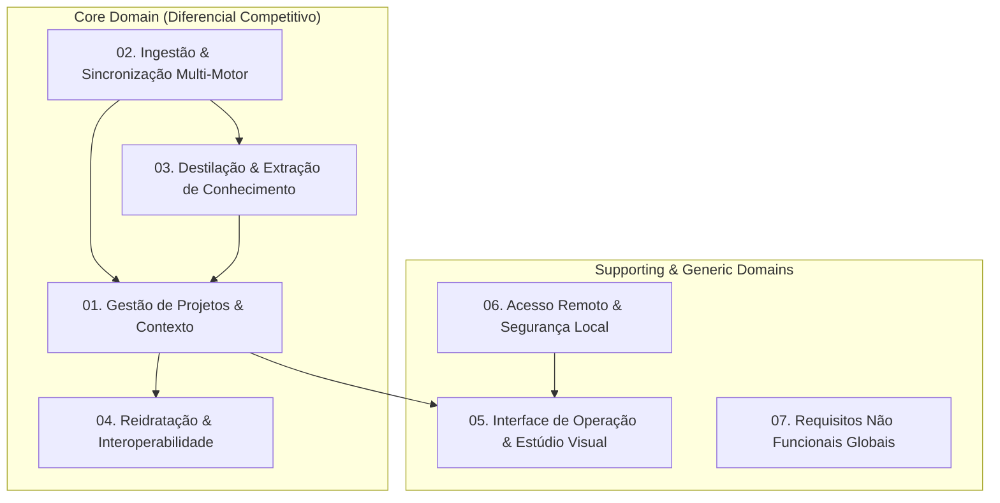

# Especificação de Requisitos e Domínios de Negócio (SDLC)
## Harness Leca

> **Documento Oficial de Engenharia de Software e Ciclo de Vida do Produto (SDLC)**  
> **Versão:** 1.0.0 | **Status:** Aprovado | **Natureza:** Local-first / Multi-Agent Workspace

---

## 1. Visão Geral do Produto e Problema de Negócio

### 1.1 O Problema
Desenvolvedores que utilizam múltiplos agentes autônomos de IA (Claude Code via terminal, Gemini/Antigravity na IDE e OpenCode) enfrentam graves problemas operacionais no fluxo diário:
1. **Silos e Fragmentação:** Cada motor armazena seu histórico de mensagens em formatos proprietários e locais distintos, impossibilitando a continuidade fluida do raciocínio.
2. **Amnésia e Perda de Contexto:** Agentes em sessões novas esquecem decisões de arquitetura tomadas em conversas passadas.
3. **Dependência de Plataforma Web Fechada:** O recurso de "Projetos" com memória e instruções persistentes era exclusivo do Claude Chat web, indisponível nativamente em CLIs e IDEs locais.
4. **Custo e Risco de Vazamento:** Ferramentas na nuvem expõem código proprietário e exigem chamadas de API pagas para interações que poderiam rodar localmente.

### 1.2 A Solução: Harness Leca
O **Harness Leca** atua como uma camada orquestradora *local-first* que replica e expande o conceito de "Projetos":
- **Isolamento de Contexto:** Instruções e memórias exclusivas por projeto.
- **Unificação Multi-Motor:** Ingestão agnóstica dos históricos do Claude Code, Gemini e OpenCode em formato único padronizado.
- **Destilação de Conhecimento:** Extração incremental de fatos duráveis para que nenhum agente perca decisões prévias.
- **Interoperabilidade Total:** Capacidade de reidratar históricos de qualquer motor de volta para o Claude Code (`claude --resume`) e agentes de IDE.
- **Privacidade Absoluta:** 100% executado localmente, sem dependência de bancos externos ou serviços de telemetria em nuvem.

---

## 2. Mapa dos Subdomínios de Negócio (Domain-Driven Design)

---

## 3. Estrutura da Especificação de Requisitos

A documentação do ciclo de desenvolvimento de software está dividida nos seguintes módulos de especificação:

| Módulo | Arquivo | Responsabilidade Principal |
|---|---|---|
| **01** | [`01-dominio-projetos-contexto.md`](file:///c:/Users/matheuss.rodrigues/git/harness-leca/docs/sdlc/01-dominio-projetos-contexto.md) | Gestão de ciclo de vida de projetos, arquivos `instructions.md`, `memory.md` e isolamento. |
| **02** | [`02-dominio-ingestao-motores.md`](file:///c:/Users/matheuss.rodrigues/git/harness-leca/docs/sdlc/02-dominio-ingestao-motores.md) | Ingestão, idempotência, parsers de Claude Code, Gemini e OpenCode. |
| **03** | [`03-dominio-extracao-conhecimento.md`](file:///c:/Users/matheuss.rodrigues/git/harness-leca/docs/sdlc/03-dominio-extracao-conhecimento.md) | Pipeline de extração LLM, rastreamento de estado incremental e destilação de regras. |
| **04** | [`04-dominio-reidratacao-agentes.md`](file:///c:/Users/matheuss.rodrigues/git/harness-leca/docs/sdlc/04-dominio-reidratacao-agentes.md) | Exportação de contexto para system prompts e sessões `.jsonl` para `claude --resume`. |
| **05** | [`05-dominio-interface-estudio.md`](file:///c:/Users/matheuss.rodrigues/git/harness-leca/docs/sdlc/05-dominio-interface-estudio.md) | Interface web local, chat multi-motor sem API paga, Vibe Studio e Escritório 2D/3D. |
| **06** | [`06-dominio-acesso-remoto-seguranca.md`](file:///c:/Users/matheuss.rodrigues/git/harness-leca/docs/sdlc/06-dominio-acesso-remoto-seguranca.md) | Autenticação por PIN temporário, rede local, QR Code e integridade de comandos. |
| **07** | [`07-requisitos-nao-funcionais-globais.md`](file:///c:/Users/matheuss.rodrigues/git/harness-leca/docs/sdlc/07-requisitos-nao-funcionais-globais.md) | Catálogo unificado de RNFs: limites de tokens, anti-monólito, performance e resiliência. |
